import Tabs from '@theme/Tabs';
import TabItem from '@theme/TabItem';
import AndroidStore from '@site/src/components/buttons/AndroidStore.mdx';
import AppleStore from '@site/src/components/buttons/AppleStore.mdx';
import LinksTelegram from '@site/src/components/_linksTelegram.mdx';
import LinksSocial from '@site/src/components/_linksSocialNetworks.mdx';
import Translate from '@site/src/components/Translate.js';
import InfoIncompleteArticle from '@site/src/components/_infoIncompleteArticle.mdx';
import ProFeature from '@site/src/components/buttons/ProFeature.mdx';

A September morning in Vancouver. More than a thousand riders roll out of Stanley Park for the RBC GranFondo Whistler: 122 kilometres of the Sea to Sky Highway, closed to traffic, with Howe Sound on one side and the mountains on the other. Past Squamish, the road starts to climb and keeps climbing all the way to Whistler.

You cross the line near the top of the results, and everyone says the same thing: you were lucky. With the weather, the wind, the group.

You know better. That result is made of dark February mornings on the seawall, Sunday climbs up Cypress, and long rides to Squamish and back, all recorded in OsmAnd one track at a time. Let’s see what a season of training looks like once Smart Folders put it in order.

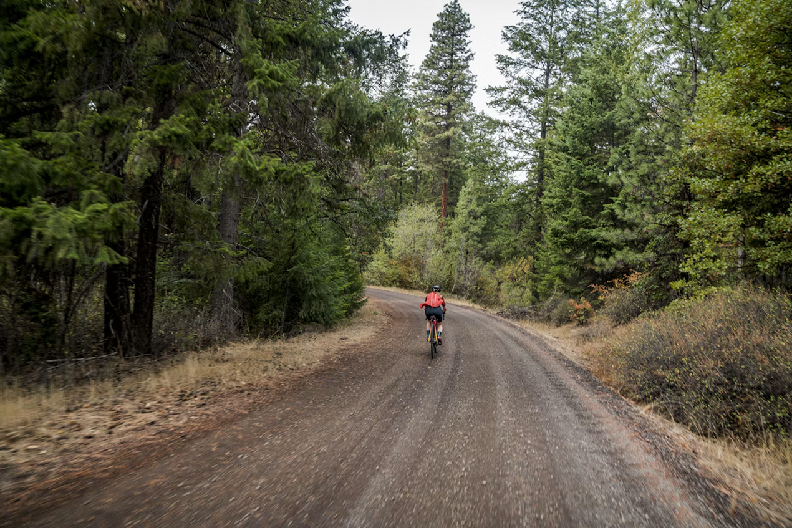

{/*truncate*/}

Photo by [Ben Guernsey](https://unsplash.com/@benguernsey) on [Unsplash](https://unsplash.com/photos/a-person-riding-a-bike-down-a-dirt-road-n7gYhVUW_T0)

## A Folder That Fills Itself

A training season doesn’t arrive neatly packed. Between the rides sit a few hikes and a drive to Whistler, and the Tracks tab lists everything by date, with no idea which recordings mattered.

A [Smart Folder](https://osmand.net/docs/user/personal/tracks/smart-folder) works the other way round: you describe the tracks you want, and OsmAnd collects them. The description is a filter that can check almost anything a track knows about itself, including length, duration, speed, elevation, date, location, activity type, and even heart rate. Set the activity to road cycling, limit the dates from February to race day, save the result as “Road to Whistler”, and the whole season lands in one place while the hikes stay out.

New rides join the folder on their own. The tracks themselves stay where they were, so deleting the folder never deletes a ride.

One catch: activity type is stored in each track, and older recordings may not have one. If some rides are missing, set their [activity](https://osmand.net/docs/user/map/tracks/track-context-menu#track-activity-type) and refresh the folder.

|| |
|:--------|:---------|
|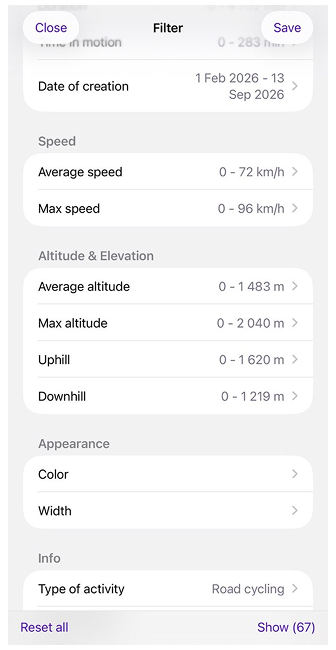| 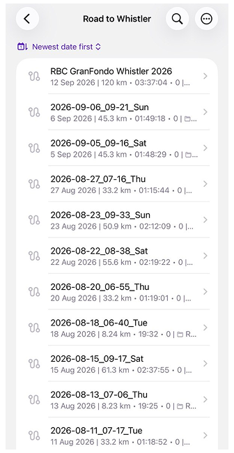 |

## One Collection, Many Views

Sixty-seven rides in one folder is tidier than a few hundred, but it’s still a list. [Organize by](https://osmand.net/docs/user/personal/tracks/smart-folder#managing-smart-folders) turns that list into groups, sorting the folder by a single parameter: activity, date, location, speed, altitude and elevation, or sensor data such as heart rate. The tracks don’t move anywhere; only the way you look at them changes.

Group the season by nearest city, and you see where the rides began: most of them in Vancouver, a handful from West Vancouver, where the long runs to Squamish set off from Horseshoe Bay, and four from Whistler, once summer made it worth driving up for the climbs. Switch to month and year, and the same folder turns into a calendar, from a cautious February to a crowded August.

Each group shows how many tracks it holds, and empty groups don’t appear at all. Below the list, OsmAnd adds everything up: tracks, distance, climbing, descent, and time in the saddle. It does this for the whole folder and for every group you open. That’s where the season starts answering questions.

|| |
|:--------|:---------|
|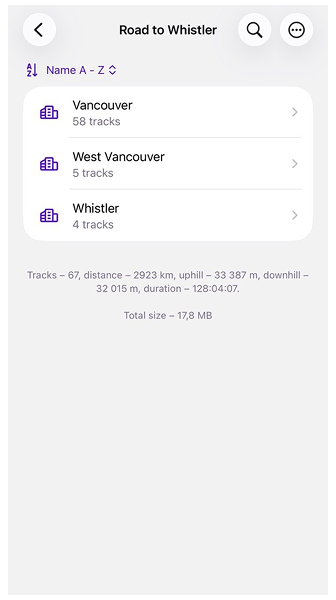| 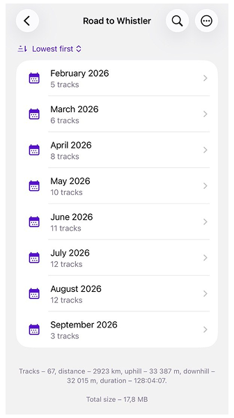 |

## Drawing the Lines Yourself

Months and cities come with natural borders. Distance doesn’t. Is a 55 km ride a long one or just a solid Tuesday? For length, duration, speed, and altitude, OsmAnd lets you decide where one group ends and the next begins.

Pick one of these parameters, and a slider asks for a step size. Drag it, and the groups rearrange behind it as you go. With a 50 km step, most of the season piles into the first group, which is honest but not very revealing. Bring it down to 20 km, and the season sorts itself out: short morning laps along the seawall, a big block of loops around UBC, the climbs on Cypress and Seymour further up, the long runs to Squamish, and, at the very end, two tracks of almost exactly the same length: the course recon in August and the race itself.

Some of this is free for everyone: grouping by activity, year of creation, and nearest city. The rest, including the monthly calendar from the previous section and every parameter with a step size, comes with [OsmAnd Pro](https://osmand.net/docs/user/purchases). Without a subscription, you can still open these options and preview how the tracks would split before deciding. If a subscription ends, the grouping you’ve already applied stays in place, and only changing it requires Pro again.

|| |
|:--------|:---------|
|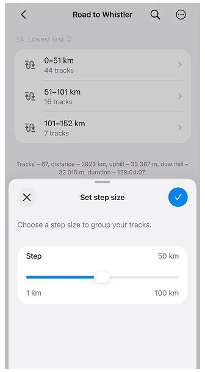| 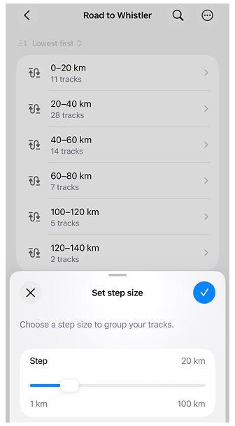 |

## Keeping It in Shape

The race is over, but the folder doesn’t retire with it. It keeps watching for rides that match its rules, and if the list ever looks out of date, a quick refresh brings it back in line. When the next season starts, there’s no need to build anything new. Edit the filter, move the dates forward, and the same folder starts collecting a new story.

Groups are useful beyond reading, too. Any of them can go straight onto the map, so a whole August of riding appears at once, from the seawall to the climbs above Whistler, every route drawn on top of the others. A group can also be exported in one go, which is handy when a coach asks to see your month and doesn’t want a dozen separate files.

If you plan the next season on a bigger screen, Smart Folders also appear in [OsmAnd Web](https://osmand.net/docs/user/web/web-tracks#smart-folders) once Settings are synced through OsmAnd Cloud. They keep working best with common parameters such as activity, dates, or distance.

|| |
|:--------|:---------|
|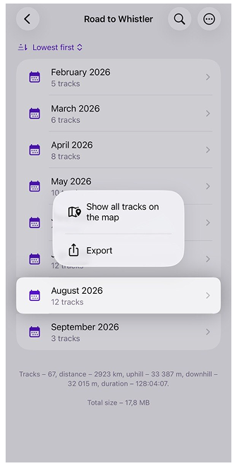| 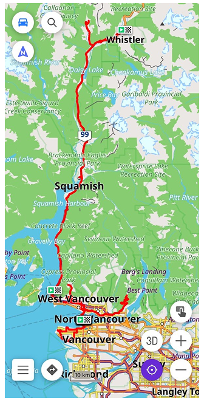 |

## The Answer to the Question

So, was it luck? Open February, and the folder answers modestly: five rides, 103 km, just over five hours on the bike, and 839 metres of climbing. Then open August: twelve rides, 577 km, a full 24 hours in the saddle, and 6,806 metres of climbing, including the day you rode the entire race course just to see how it would feel.

|| |
|:--------|:---------|
|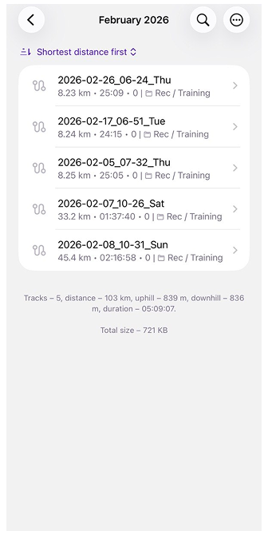| 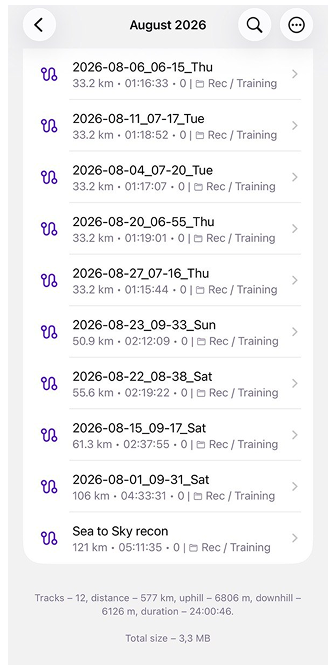 |

The whole season fits into a single line at the bottom of the folder: 67 rides, 2,923 km, and more than 33,000 metres of climbing. That’s nearly four times the height of Everest, collected one Cypress hairpin at a time.

No tailwind delivers that. So the next time someone tells you how lucky you were, there’s no need to argue. Just open the folder and hand them your phone.

:::info[Share Your Story]
Every track in OsmAnd has a person and a story behind it. If you’d like to share yours on our blog, whether it’s a long journey, a season of training, or a route you simply love, we’d be glad to hear from you. Write to [Tina](https://github.com/TinaPohor), and we’ll make it happen together.
:::

______________________________________________

We appreciate your interest in us and thank you for taking the time to read this article. Join us on social media to keep up to date with the latest news and share your experiences. Your opinion is important to us.

Follow OsmAnd on Facebook, TikTok, X (Twitter), Reddit, and Instagram!

Join us at our groups of Telegram: (OsmAnd News channel), (EN), (IT), (FR), (DE), (UA), (ES), (BR-PT), (PL), (AR), (TR).