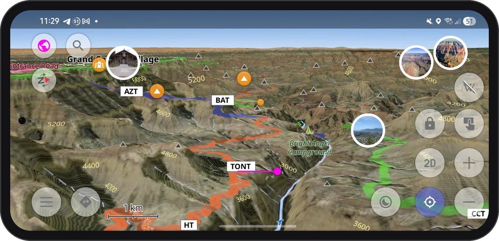
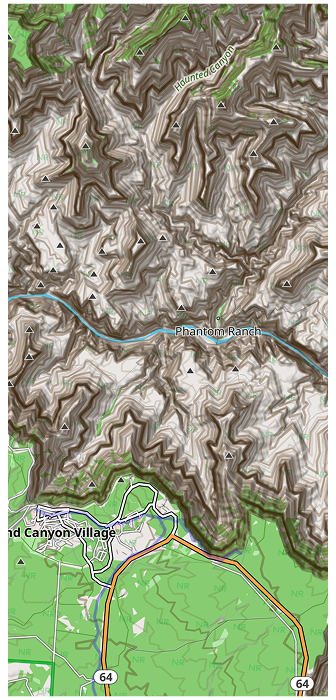
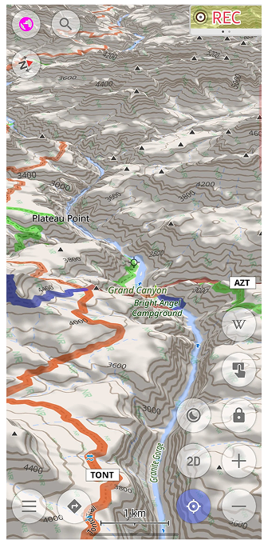

import AndroidStore from '@site/src/components/buttons/AndroidStore.mdx';
import AppleStore from '@site/src/components/buttons/AppleStore.mdx';
import LinksTelegram from '@site/src/components/_linksTelegram.mdx';
import LinksSocial from '@site/src/components/_linksSocialNetworks.mdx';

If you hike, ski, or drive in North America, your OsmAnd terrain may already be much sharper than you think. Since spring 2026, terrain maps and contour lines for the United States (including Alaska), Canada, and Mexico are built from high-resolution national elevation data. If you have not updated these maps since then, you are still looking at the old, smoother relief.

{/*truncate*/}

## What Changed

The new maps use elevation data with about 10 m resolution in the mainland United States and about 30 m in Alaska and most of Canada and Mexico. In practice, that means smaller ridges, narrower gorges, and steeper cliffs show up where the map used to smooth them out.

The update covers two map types:

- [Terrain maps (3D)](https://osmand.net/docs/user/plugins/topography#3d-relief-maps) — the base for [3D relief](https://osmand.net/docs/user/plugins/topography#3d-relief), [Hillshade, and Slope](https://osmand.net/docs/user/plugins/topography#hillshade-slope-and-altitude-layers) layers.
- [Contour lines](https://osmand.net/docs/user/plugins/topography#contour-lines) — regenerated from the same new data, so they match the relief exactly.

More detail takes a bit more space: updated maps are up to one and a half times larger than before.

Data: [USGS 3D Elevation Program](https://www.usgs.gov/3d-elevation-program) (via [The National Map](https://apps.nationalmap.gov/downloader/) and [OpenTopography](https://opentopography.org/)), including data from [Natural Resources Canada (NRCan)](https://natural-resources.canada.ca/) and [INEGI (Mexico)](https://www.inegi.org.mx/).

## Updated Regions

- United States, including Alaska
- Most of Canada and Mexico

## See It in the Grand Canyon

|| |
|:--------|:---------|
||  |

Few places test a terrain map like the Grand Canyon. Seen from above, the side canyons branch out in fine detail, and the contour lines follow every bend of the walls down to the Colorado River.

Tilt the map into 3D, and the canyon rises off the screen: Plateau Point, Skeleton Point, and the trail down to Phantom Ranch sit right where the terrain says they should.

<iframe
  width="315"
  height="560"
  src="https://www.youtube.com/embed/anoHS_9k-U4"
  title="Grand Canyon in 3D in OsmAnd"
  frameBorder="0"
  allow="accelerometer; autoplay; clipboard-write; encrypted-media; gyroscope; picture-in-picture; web-share"
  allowFullScreen
></iframe>

## Works Offline

Terrain maps are stored on your device, just like the rest of your OsmAnd maps. Once downloaded, the relief, contour lines, and 3D view keep working without an internet connection, which is handy at the bottom of a canyon, where signal is rarely part of the scenery.

## How to Get the Update

Terrain maps downloaded before May 2026 still contain the old data. Open the [Updates tab](https://osmand.net/docs/user/personal/maps-resources#updates-menu) in Maps & Resources: if terrain or contour line maps for these regions are listed, update them. There is no need to delete the old files first. If you do not have them yet, download the [Terrain map (3D)](https://osmand.net/docs/user/plugins/topography#3d-relief-maps) and [Contour lines](https://osmand.net/docs/user/plugins/topography#contour-lines-meters-or-feet) for the regions you need. Terrain and contour line maps require [OsmAnd Maps+ or Pro](https://osmand.net/docs/user/purchases/); 3D relief requires OsmAnd Pro.

## Questions or Issues

If something looks off or you have questions, contact OsmAnd support at support@osmand.net, or visit the [Support page](https://osmand.net/help-online/support/) for more help options.

______________________________________________

**We appreciate your interest in us and thank you for taking the time to read this article. Join us on social media to keep up to date with the latest news and share your experiences. Your opinion is important to us.**

- **Follow**: <LinksSocial/>

- **Join**: <LinksTelegram/>

- **Get**: &nbsp;<AndroidStore/> <AppleStore/>