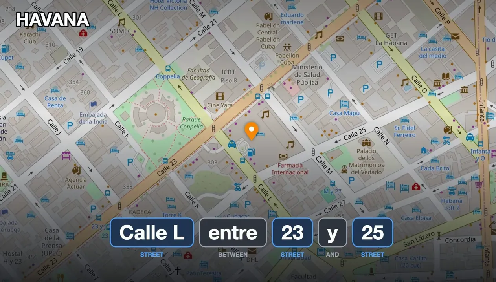
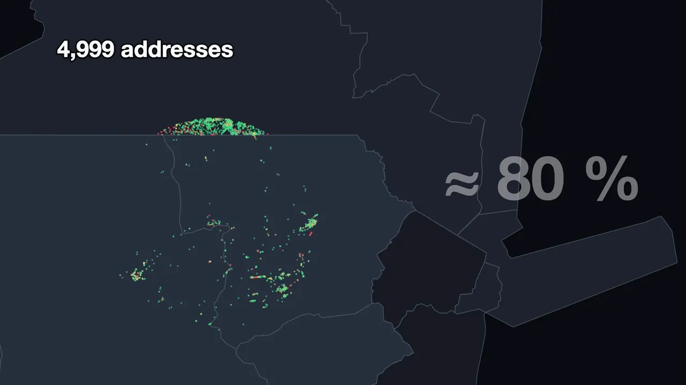
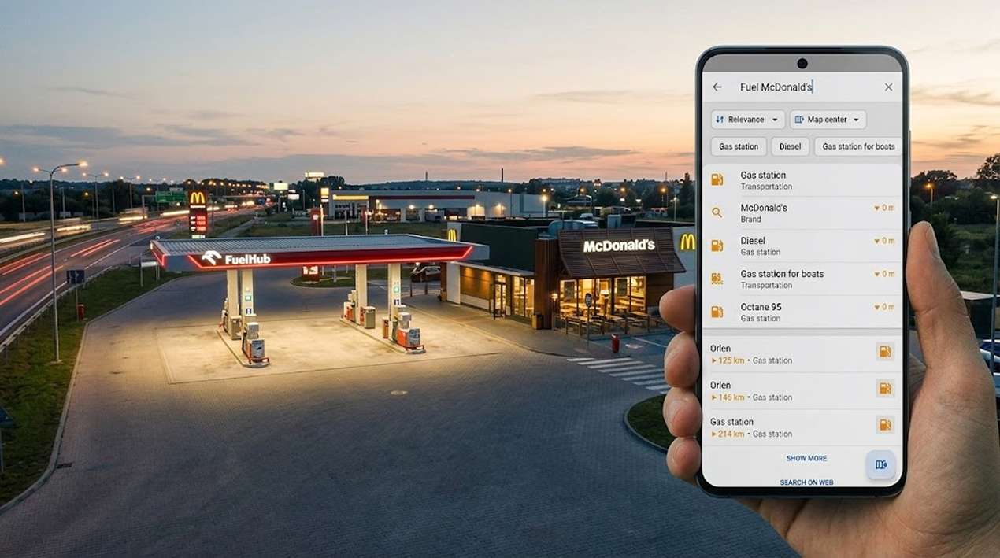

import AndroidStore from '@site/src/components/buttons/AndroidStore.mdx';
import AppleStore from '@site/src/components/buttons/AppleStore.mdx';
import LinksTelegram from '@site/src/components/_linksTelegram.mdx';
import LinksSocial from '@site/src/components/_linksSocialNetworks.mdx';
import Librarian from '@site/src/components/OfflineSearch/Librarian';
import WordsOnMap from '@site/src/components/OfflineSearch/WordsOnMap';
import Zipper from '@site/src/components/OfflineSearch/Zipper';
import Tetris from '@site/src/components/OfflineSearch/Tetris';
import AddressExamples from '@site/src/components/OfflineSearch/AddressExamples';

  <iframe
    src="https://www.youtube.com/embed/aScKKQvZx3U"
    title="Why Offline Search Is So Hard"
    style={{position: 'absolute', top: 0, left: 0, width: '100%', height: '100%', border: 0}}
    allow="accelerometer; autoplay; clipboard-write; encrypted-media; gyroscope; picture-in-picture; web-share"
    referrerPolicy="strict-origin-when-cross-origin"
    allowFullScreen
  ></iframe>

If you have ever typed an address into OsmAnd and got a street in another town — or nothing at all — you are not alone. Search has been the most common complaint we hear, and in our 2026 survey it came up again and again in every language. So this year we did not patch it once more. We built a new search engine from scratch, and **it comes to everyone with OsmAnd 5.5**. If you don't want to wait, it is already in our [nightly builds](https://osmand.net/docs/versions/nightly_versions).

The video above tells the whole story in 23 minutes. Below is the short version, with a few interactive demos so you can play with the same ideas the new engine uses.

{/*truncate*/}

## What Changes for You

- **Addresses typed your way.** «Unter den Linden 10» or «10 Unter den Linden», «S Mountain Blvd» for South Mountain Boulevard, a postcode or a state instead of a town.
- **Typos corrected.** Misspell a word and search offers the right one: «leopoldstrase 10» → *Leopoldstraße 10*, «mnuc» → *München*.
- **Suggestions as you type.** Start a word and search offers the most common words that continue it — tap one instead of typing the rest.
- **Public services by the name people use.** «DMV» finds motor vehicle offices and «NHS» finds NHS clinics, even when the map lists the organisation only as the operator.
- **Categories in more words and languages.** Categories match common synonyms and work in your language, in English, and in the local language: with the app in English, both «school» and «Schule» find schools in Germany.
- **Places next to places.** «Fuel McDonald's» finds gas stations with a McDonald's nearby; «Shell» on a named street; two streets that cross.
- **Faster and measured.** The search itself is about five times faster, and every change now runs against 137,000 real searches in 28 test sets — 99.5% of them are found.

## Why Is This So Hard Offline?

Google can afford to be clever: every query goes to a server that has learned from billions of searches, corrections, and taps. OsmAnd has no server. Everything happens on your phone, inside the map files you downloaded — so the phone itself has to work out what you meant.

And addresses have no grammar book. Every country writes them its own way, and people mix the parts in any order. The same line of text can mean two different places:

<AddressExamples/>

## First, Measure

For years every release fixed some search bugs, and every year 50 to 90 new ones came in. Users told us almost nothing works; we could not reproduce a single bug ourselves. So in 2025 we stopped guessing and built a test bench: take thousands of real addresses from the map, type each one the way a person would, and count how many are found.

The first honest number was about 80%. Every user report with a real address became another test — and the bench, not our feeling, started deciding what is fixed.

## The Old Way: a Librarian

The old search worked like a librarian: find the town, walk along its shelf of streets, open the street, find the house. It works well in a small town. It works much worse when the town is London — one shelf with 56,266 streets — or when there is no town at all and a single word can be a village, a street, or a hospital. Try it:

<Librarian/>

Every address that broke got its own patch: townships, word order, abbreviations. Each patch fixed one address and broke another, and together they became slow and fragile. One user with eighty maps installed waited more than two minutes for the right result.

## The New Idea: Put the Words on the Map

We are searching a map, after all. So instead of walking shelves, the new engine lights up every word of the query on the map, and looks for the places where the lights meet. A street and its town meet because their areas overlap; a McDonald's and a gas station meet because they stand next to each other. Since June 2026 every street and every town in OsmAnd maps carries its own area for exactly this.

Here are the real objects the engine finds in Portugal for one long query. Pick the words and watch the map:

<WordsOnMap/>

## The Zipper

Comparing every object of one word with every object of another would take hundreds of millions of checks — more than half a minute for a single search. The trick is the same one every web map uses: tiles. The world is cut into four squares, each of them into four again, and so on, and every tile gets a number along a Z-shaped curve. Two tiles never overlap partially — they are either apart or one sits inside the other.

So each word becomes a sorted list of tile numbers, and two words are joined by walking both lists at once, like a zipper. Pairs that can't meet are never looked at:

<Zipper/>

An advanced version of the zipper jumps between tile levels — a town is a big tile, a street a small one — and skips whole regions where the other word has nothing. Half a minute became 50 milliseconds.

## Tetris With Words

Long queries, like a crossing of two streets, add one more twist. Each object covers only some of the words, so the answer is a set of pieces that covers every word exactly once — and also meets on the map. It is a classic hard problem, the same family as Sudoku. The engine plays it like Tetris: pieces dock into a row, every docking is checked on the map, and a row that drops to zero disappears together with everything that could have been built on it.

This is the engine's real trace for «Travessa de Santo António, Rua Joaquim Ribeiro de Carvalho, Portugal»:

<Tetris/>

## Where We Are Now

The new engine went from its first test run in July 2026 to beating the old search two days later, and kept climbing. Today 99.5% of the 137,000 test searches are found. In Pennsylvania, where we started, the addresses we could not find went from 206 to 40 to 7 — and those last seven are broken in OpenStreetMap itself.

It also handles queries the old search never could, like a McDonald's next to a gas station.

Not everything is solved. Havana's *Calle L, between 23 and 25* has no house number, only the two streets around it, and we still can't find it. Ranking, typos, and common words each deserve a story of their own.

## Try It and Help

The new search comes with **OsmAnd 5.5**. You can try it today in our [nightly builds](https://osmand.net/docs/versions/nightly_versions), and as always the code is on [GitHub](https://github.com/osmandapp/OsmAnd).

- **Tell us what you typed.** When search can't find something, send us the exact query — every miss becomes a test.
- **Help the map.** A street without a name can't be found, and streets inside a town without a boundary may be missed. Add names and draw boundaries in OpenStreetMap.

The video has subtitles in 7 languages and dubbed audio in German, French, Italian, and Spanish.

______________________________________________

**We appreciate your interest in us and thank you for taking the time to read this article. Join us on social media to keep up to date with the latest news and share your experiences. Your opinion is important to us.**

- **Follow**: <LinksSocial/>

- **Join**: <LinksTelegram/>

- **Get**: &nbsp;<AndroidStore/> <AppleStore/>
