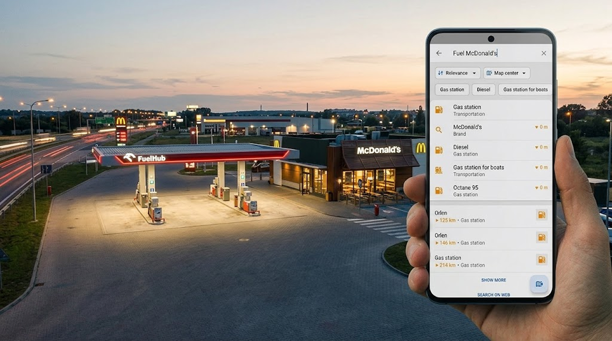
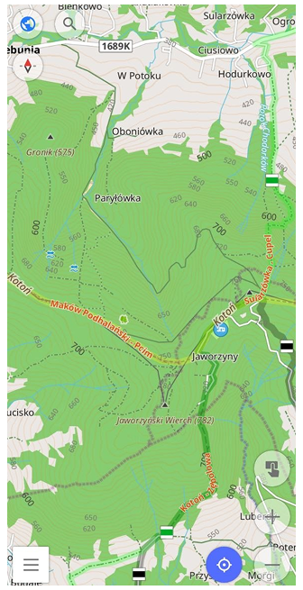
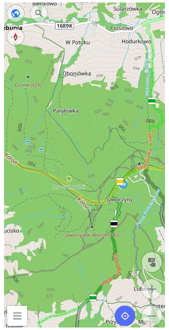

import Tabs from '@theme/Tabs';
import TabItem from '@theme/TabItem';
import AndroidStore from '@site/src/components/buttons/AndroidStore.mdx';
import LinksTelegram from '@site/src/components/_linksTelegram.mdx';
import LinksSocial from '@site/src/components/_linksSocialNetworks.mdx';
import Translate from '@site/src/components/Translate.js';
import InfoIncompleteArticle from '@site/src/components/_infoIncompleteArticle.mdx';
import ProFeature from '@site/src/components/buttons/ProFeature.mdx';
import InfoAndroidOnly from '@site/src/components/_infoAndroidOnly.mdx';

OsmAnd 5.5 for Android is now available on Google Play. Update the app to explore the new features and improvements.

This release is built around search: the new Spatial Search is now on by default and finds what you mean, even when you type it your own way. Cities also gain depth with realistic shadows from 3D buildings and terrain, Panoramax brings street-level imagery to the map, and the new Media library keeps all your photos, videos, and audio notes in one place.

[🔄 **Update Now!**](https://play.google.com/store/apps/dev?id=8483587772816822023)

Thanks to all our users for their feedback and suggestions. Your input is invaluable in helping us improve OsmAnd and make it the best navigation app for Android.

{/*truncate*/}

## What's new

- [Spatial Search on by default](#spatial-search-is-on-by-default): search around a place, better ranking, synonyms, and suggested corrections
- [Sun shadows for 3D buildings and terrain](#sun-shadows-for-3d-buildings-and-terrain)
- [Panoramax plugin](#panoramax-plugin): street-level imagery on the map
- [Media library](#media-library): all photos, videos, and audio notes in one place
- [Dashed and dotted track lines](#dashed-and-dotted-track-lines)
- [Travel speed settings](#travel-speed-settings) for routing and arrival time
- [Android Auto updates](#android-auto-updates): recent destinations, automatic Free ride, Google Assistant and Gemini
- [Quick action to show or hide tracks](#quick-action-to-show-or-hide-tracks)
- [Contour line labels face uphill](#contour-line-labels-face-uphill)
- [Support for BLE power meters](#support-for-ble-power-meters)
- [Other updates and improvements](#other-updates-and-improvements)
- [Bug fixes](#bug-fixes).

## Spatial Search is on by default

Search was the feature you asked us to fix most often, so for OsmAnd 5.5 we rebuilt it from scratch. [**Spatial Search**](https://osmand.net/docs/user/search/search-all#spatial-search), introduced as an experimental option in 5.4, is now enabled for everyone.

The new engine looks at where each word of your query sits on the map and finds the places where they meet. In practice, this means:

- **Addresses typed your way.** `Unter den Linden 10` and `10 Unter den Linden` both work, as do abbreviations like `S Mountain Blvd`, or a postcode or state instead of a town.
- **Corrections for typos.** Misspell a word, and search suggests the right one: `mnuc` leads you to *München*.
- **Suggestions as you type.** Start a word and tap one of the suggested endings instead of typing the rest.
- **Categories in more words and languages.** Categories understand common synonyms and work in your language, in English, and in the local language.
- **Places next to places.** `Fuel McDonald's` finds gas stations with a McDonald's nearby.
- **Speed.** The search itself is about five times faster.

Want to know why offline search is so hard and how we solved it? Watch the video and try the interactive demos in [Why Offline Search Is So Hard](https://osmand.net/blog/offline-search-video).

## Sun shadows for 3D buildings and terrain

Last release gave [**3D Buildings**](https://osmand.net/docs/user/plugins/topography#3d-buildings) their roofs. This one lets the sun do its work: buildings and relief now cast realistic shadows on the map.

Turn on **Shadows** in the Sun settings of 3D buildings. The shadows follow the sun direction you set there, so you can see how a street or a valley looks with light from different sides.

## Panoramax plugin

The new **Panoramax** plugin shows street-level imagery from Panoramax, a federated and openly licensed photo mapping platform, as a layer on the map. It helps you check what an area looks like, see existing coverage, and plan what still needs to be photographed.

You can filter imagery by **contributor**, **date**, or **type**, and show or hide the layer with a dedicated Quick action. Panoramax photos are available online only.

## Media library

Photos, videos, and audio notes now have a home of their own. The new **Media library** in [**My Places**](https://osmand.net/docs/user/personal/myplaces) gathers everything you record on the map or [attach to a Favorite](https://osmand.net/docs/user/personal/favorites#media).

Browse files in a grid, group them, and sort them, including by file size. Each file shows what it is attached to, and a file that is not attached yet can be attached to a Favorite right from the library.

- **Detach** removes a file from a Favorite, while the file stays on your device and in the Media library.
- **Delete** removes the file from your device and from every Favorite it is attached to.

## Dashed and dotted track lines

Tracks get a new **Line style** option in [**track appearance**](https://osmand.net/docs/user/map/tracks/appearance#track-appearance-settings): **Solid**, **Dashed**, or **Dotted**. Different line styles make it easier to tell planned routes, recorded trips, and alternatives apart at a glance.

Dashed and dotted styles work with a solid track color. The line style is also part of a folder's default appearance, so new tracks in that folder get it automatically.

## Travel speed settings

The new **Travel speed** settings in [**vehicle parameters**](https://osmand.net/docs/user/navigation/guidance/vehicle-parameters#default-speed) bring together everything OsmAnd uses to calculate your route and arrival time.

- **Default speed** — used when there is no speed data for the road, or while you stand still.
- **Speed range** — used for both route calculation and arrival time.
- **Adapt to my speed** — bases the estimated arrival time on how fast you actually moved recently, instead of the expected speed on each road of the route.

## Android Auto updates

[**Android Auto**](https://osmand.net/docs/user/navigation/auto-car) gets a few changes that save you taps on the road.

### Recent destinations on the launcher

OsmAnd now shows up to five recent destinations as cards on the Android Auto launcher, newest first. Tap a card to head there without opening the app menu. The cards are hidden during navigation.

### Automatic Free ride

When no route is set and the car has been moving for a short while, OsmAnd switches to **Free ride** by itself. This is handy when you stop often and Android Auto reconnects every time you turn the engine back on.

### Google Assistant and Gemini

During navigation, you can control OsmAnd [by voice](https://osmand.net/docs/user/navigation/auto-car#voice-control): mute or unmute voice prompts, end navigation, or avoid tolls.

## Quick action to show or hide tracks

A new [**Quick action**](https://osmand.net/docs/user/widgets/quick-action#my-places) lets you show or hide tracks with a single tap. Pick one or several tracks, or all of them, when setting up the action. Or set it to open the track list every time, so you can choose on the go.

## Contour line labels face uphill

[**Contour lines**](https://osmand.net/docs/user/plugins/topography#contour-lines) get a new **Label direction** setting. Choose **Upright** to keep the numbers easy to read, or **Uphill** to read the terrain like a paper topographic map: the top of each height number faces higher ground, and the short ticks on the lines point downhill.

|| |
|:--------|:---------|
||  |

## Support for BLE power meters

The [**External sensors**](https://osmand.net/docs/user/plugins/external-sensors) plugin now supports Bluetooth Low Energy (BLE) power meters, so cyclists without ANT+ on their phone can connect them too.

## Other updates and improvements

- **Navigation settings in route links.** A shared route link now includes the navigation settings.  

- **[Start from notification.](https://osmand.net/docs/user/plugins/trip-recording#notifications)** The trip recording "Notification" option is renamed to make clear what it does: it shows a notification with a button to start recording. While recording, a notification is always shown.  

- **Average vertical speed.** The Average glide ratio widget can show average vertical speed.  

- **Permissions for connected apps.** Apps that use the OsmAnd API ask for access by group, such as map, search, navigation, or tracks. You can change these permissions later in Plugins.  

- **Battery saving mode** in General settings limits the map to 20 frames per second to reduce battery drain and device heating.  

- **[Opening hours](https://osmand.net/docs/user/map/map-context-menu#object-info)** show public holidays and school holidays in your language. 

- **[OsmAnd Cloud](https://osmand.net/docs/user/personal/osmand-cloud)** warns about files with names too long for your device, so you can rename them in OsmAnd Cloud.  

## Bug fixes 

- Fixed [emptying the OsmAnd Cloud trash restoring deleted data](https://github.com/osmandapp/OsmAnd/issues/24228).
- Fixed [route recalculation announcements that didn't match the actual deviation from the route](https://github.com/osmandapp/OsmAnd/issues/25544).
- Fixed [the compass pointing 180° off in inverted portrait orientation](https://github.com/osmandapp/OsmAnd/issues/26147).
- Fixed [the speed limit sign not showing in Android Auto until the phone screen is turned on](https://github.com/osmandapp/OsmAnd/issues/26441).
- Fixed [all intermediate points being passed at once when one of them is far from the route](https://github.com/osmandapp/OsmAnd/issues/25842).
- Fixed [the recorded track disappearing from the map with Join segments enabled](https://github.com/osmandapp/OsmAnd/issues/25608).
- Restored [stops with zero speed in speed charts](https://github.com/osmandapp/OsmAnd/issues/26351).
- Fixed [the trip recording Start button disappearing with a large font or display size](https://github.com/osmandapp/OsmAnd/issues/26305).
- Fixed [track appearance not applying after Cloud sync until the track was hidden and shown again](https://github.com/osmandapp/OsmAnd/issues/25686).
- Restored [OSMC symbols in the What's here list that opens when you tap overlapping route shields](https://github.com/osmandapp/OsmAnd/issues/26148).
- Updated [solar eclipse times to show local times instead of worldwide ones](https://github.com/osmandapp/OsmAnd/issues/25830).
- Fixed [the parking position marker not showing when Favorites are hidden](https://github.com/osmandapp/OsmAnd/issues/23115).
- Fixed [imported Favorites going to the wrong folder](https://github.com/osmandapp/OsmAnd/issues/25775).
- Fixed [back navigation in Address search returning to the previously opened city](https://github.com/osmandapp/OsmAnd/issues/25748).
- Fixed [pinch-to-zoom in Plan a route](https://github.com/osmandapp/OsmAnd/issues/26443).
- Fixed [the Display position setting not always matching the map center](https://github.com/osmandapp/OsmAnd/issues/25604).
- Fixed [folder names being cut at the last dot when importing folders](https://github.com/osmandapp/OsmAnd/issues/24584).
- Fixed [online maps not working when the data storage folder is on an SD card](https://github.com/osmandapp/OsmAnd/issues/25510).

_______________________

If you have suggestions for improving the Android version of the app, please get in touch with us. We appreciate and welcome your contribution to the further development of OsmAnd.

__________________________________________________________

- **Follow**: <LinksSocial/>  

- **Join**: <LinksTelegram/>  

- **Get**: &nbsp;<AndroidStore/>