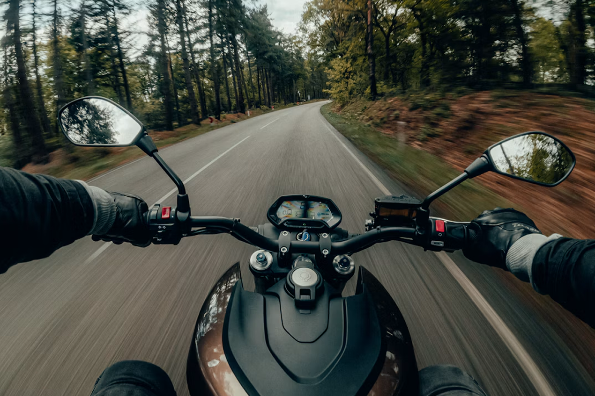
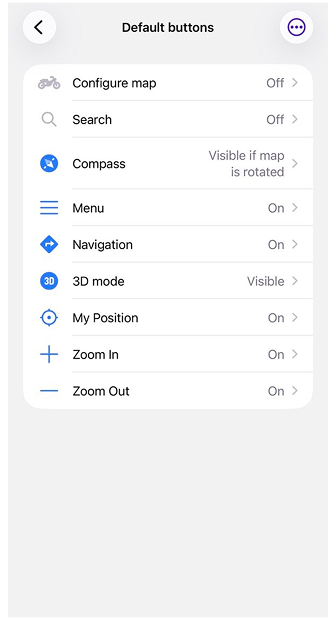
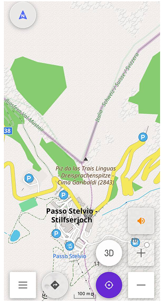
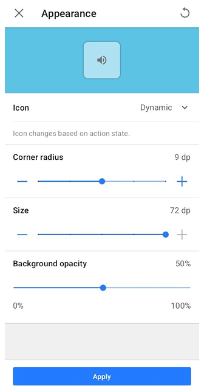
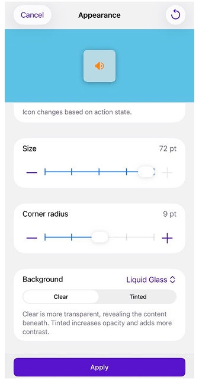
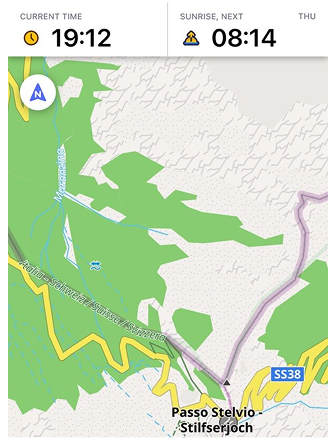
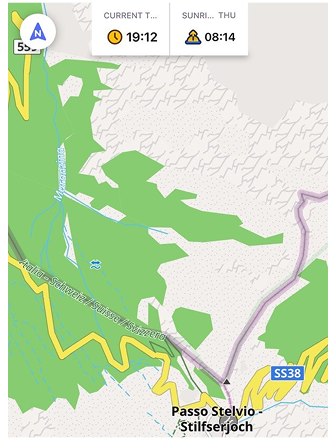
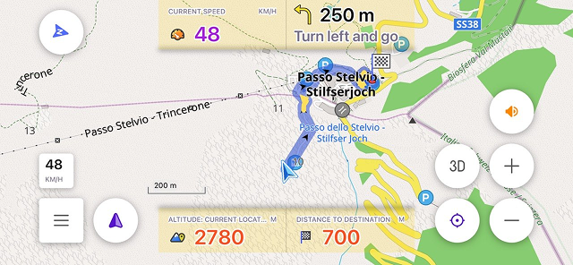

import Tabs from '@theme/Tabs';
import TabItem from '@theme/TabItem';
import AndroidStore from '@site/src/components/buttons/AndroidStore.mdx';
import AppleStore from '@site/src/components/buttons/AppleStore.mdx';
import LinksTelegram from '@site/src/components/_linksTelegram.mdx';
import LinksSocial from '@site/src/components/_linksSocialNetworks.mdx';
import Translate from '@site/src/components/Translate.js';
import InfoIncompleteArticle from '@site/src/components/_infoIncompleteArticle.mdx';
import ProFeature from '@site/src/components/buttons/ProFeature.mdx';

Think of a painting you really liked. You probably don't remember the frame, and that's the best thing you can say about a frame. It was there to hold the picture, and that's all.

On the OsmAnd screen, the map is the picture. Buttons, widgets and the compass in the corner are the frame. With the phone in your hand on a city street, you hardly see them. Then one day the phone goes onto the handlebar of a motorcycle, sideways, you pull on your gloves, and now the frame is all you see. The zoom buttons sit right on the road you're about to take, the search button hides the next village, and pressing the right thing with a glove on is mostly luck.

The map didn't change. The frame just got too big for it. So let's make it smaller, quieter and easier to hit with gloves, and make sure it stays out of the way when the phone turns.

{/*truncate*/}

Photo by [Gijs Coolen](https://unsplash.com/@gijsparadijs) on [Unsplash](https://unsplash.com/photos/black-and-gray-motorcycle-on-road-during-daytime-CRmcBeINxtg)

## What Stays in the Frame

The easiest way to give the map more room is to show fewer buttons. In [Default buttons](https://osmand.net/docs/user/widgets/configure-screen#default-buttons), every standard button has its own switch, so you can just turn off the ones you don't use on the bike. Search, for example. You won't be looking anything up while riding, and at a stop you'll take the phone in your hand anyway. The [compass](https://osmand.net/docs/user/widgets/map-buttons#compass) can stay, but set it to appear only when the map is rotated.

If there's something you do on almost every ride, you can give it a separate button. [Custom buttons](https://osmand.net/docs/user/widgets/quick-action#custom-buttons) are made from Quick Actions. With a helmet headset, for example, it could be a button that turns voice prompts off and back on, so you don't have to go into the settings for that.

Custom buttons can be moved with a long press, so you can put them where they're easier to reach. They snap to an [invisible grid](https://osmand.net/docs/user/widgets/quick-action#grid-layout-for-buttons) in the corners of the screen, and when widgets or panels change, OsmAnd shifts them so they don't overlap.

|| |
|:--------|:---------|
||  |

## Buttons You Can Hit with Gloves On

Take the voice prompts button from the previous section. On the map it looks small and tidy, and that's fine right up until you try to press it with a glove on. Every button has its own [appearance settings](https://osmand.net/docs/user/widgets/map-buttons#map-button-appearance), and on Android you can also change all default buttons in one go (on iOS, it's one button at a time).

Start with the icon, because it can do more than just sit there. A dynamic icon changes with the state of the action, so the button itself tells you what's going on. You can also give a button the icon of one of the actions you've added. And if you'd rather it always looked the same, pick a specific icon and it won't change.

Then make it bigger. Drag Size up, and the button becomes something your thumb finds without searching. Corner radius changes the shape, from sharp square corners to smooth rounded ones. A little rounding is usually enough.

A bigger button covers more of the road, though, and that's what the background is for. On Android, Background opacity goes from 0 to 100%: keep the button solid, make it partly transparent, or turn it down until only the icon with a light shadow is left. On iOS, the Background setting has two types. Solid works the same way, with an opacity slider from 0 to 100%. Liquid Glass turns the button into a piece of glass on top of the map: Clear lets more of the map show through, and Tinted makes it a bit more solid when there's a lot going on behind it.

Every change shows up right away in the preview, so you can play with it until the button feels right, and only then save it.

|| |
|:--------|:---------|
||  |

## Portrait or Landscape

|| |
|:--------|:---------|
||  |

Painters had these two words long before phones did. A portrait is tall, a landscape is wide, and nobody expects one picture to work in both. On a motorcycle, you get both in one day. The phone rides sideways on the handlebar, and at a stop you take it in your hand and hold it upright.

By default, OsmAnd uses the same widgets in both orientations, so whatever you set up for the handlebar follows you into portrait too. To keep them apart, turn on [Separate layouts](https://osmand.net/docs/user/widgets/configure-screen#single-and-separate-layouts) on Android or set Screen elements to Independent on iOS. Configure screen then has Portrait and Landscape tabs, and changes in one don't touch the other. You don't have to start from scratch, either: a panel's widget list can be copied from the other orientation and adjusted from there.

The top and bottom panels also need to get along with the map buttons, and in landscape, where the screen is wide but not very tall, they end up right next to each other. [Panels layout](https://osmand.net/docs/user/widgets/configure-screen#panels-layout) decides how they share the space. Wide stretches the top and bottom panels across the whole screen, and Compact fits them between the side panels and the map buttons. You can choose it separately for portrait and landscape (on Android, the option appears once Separate layouts is on).

The widgets themselves can be adjusted too, [panel by panel](https://osmand.net/docs/user/widgets/configure-screen#widget-panel-appearance): their height, whether icons are shown, text colors for day and night, and the background, which can also be transparent. A custom background color is a [paid feature](https://osmand.net/docs/user/purchases/). If one panel or another profile already looks the way you like, you can copy its appearance instead of setting everything again. On iOS with Independent screen elements, all of this is set separately for each orientation.

## A Frame for Every Trip

All of this belongs to one profile. The screen you put together for the motorcycle stays in the Motorcycle profile, and the ones you use on foot or in the car stay exactly as they were. Nothing you changed for the handlebar follows you into the city.

If another profile should get the same buttons, you don't have to set them up again. In Default buttons, Copy from another profile brings over which buttons are visible and how they look. Custom buttons are shared between profiles, and in each one you just decide whether a button shows up. Switching profiles can be a Quick Action as well, so going from the bike to walking around town takes one tap.

Back to the painting from the beginning. A good frame is the one you don't remember, and after a day on the road, you probably won't remember the buttons either. Just the road.

______________________________________________

**We appreciate your interest in us and thank you for taking the time to read this article. Join us on social media to keep up to date with the latest news and share your experiences. Your opinion is important to us.**

- **Follow**: <LinksSocial/>

- **Join**: <LinksTelegram/>

- **Get**: &nbsp;<AndroidStore/> <AppleStore/>