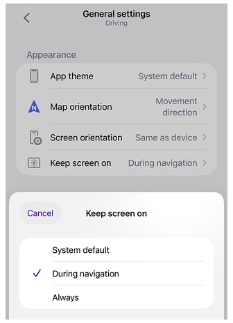
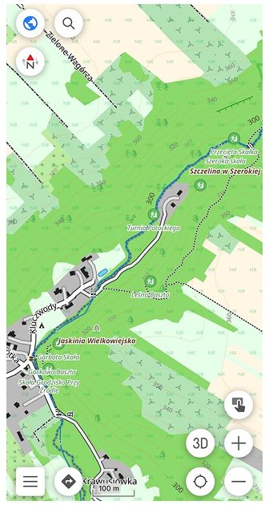
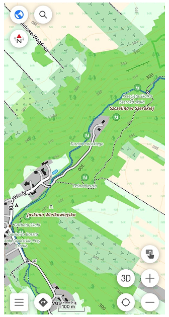

import Tabs from '@theme/Tabs';
import TabItem from '@theme/TabItem';
import AndroidStore from '@site/src/components/buttons/AndroidStore.mdx';
import AppleStore from '@site/src/components/buttons/AppleStore.mdx';
import LinksTelegram from '@site/src/components/_linksTelegram.mdx';
import LinksSocial from '@site/src/components/_linksSocialNetworks.mdx';
import Translate from '@site/src/components/Translate.js';
import InfoIncompleteArticle from '@site/src/components/_infoIncompleteArticle.mdx';
import ProFeature from '@site/src/components/buttons/ProFeature.mdx';

OsmAnd 5.5 has reached iPhone, iPad, and CarPlay, and the update is already waiting for you in the App Store.

This update brings EPSG coordinate systems, separate widget layouts for Portrait and Landscape, appearance settings for widget panels, new CarPlay settings, and many other improvements and bug fixes.

[🔄 **Update Now**](https://itunes.apple.com/us/app/osmand-maps-travel-navigate/id934850257)

{/*truncate*/}

## What's new

- [New coordinate formats](#new-coordinate-formats): EPSG systems, Maidenhead, and Swiss Grid
- [Separate widget layouts](#separate-widget-layouts-for-portrait-and-landscape) for Portrait and Landscape
- [Appearance settings for widget panels](#appearance-settings-for-widget-panels)
- [CarPlay updates](#carplay-updates): map orientation, Home in one tap, and frame rate limit
- ["Keep screen on" setting](#keep-screen-on) for each profile
- [Contour line labels face uphill](#contour-line-labels-face-uphill)
- [Full appearance settings](#full-appearance-settings-for-several-favorites) for several Favorites at once
- [Intermediate destinations in route details](#intermediate-destinations-in-route-details)
- ["Nearest to map center" sorting](#nearest-to-map-center-sorting-for-tracks) for tracks
- [Holidays in opening hours](#holidays-in-opening-hours)
- [Other updates and improvements](#other-updates-and-improvements)
- [Bug fixes](#bug-fixes).

## New coordinate formats

OsmAnd for iOS now supports a much wider range of [**coordinate formats**](https://osmand.net/docs/user/search/search-coordinates#customize-coordinate-format), which is useful for field work, surveying, amateur radio, and any activity that relies on a specific coordinate system.

* **EPSG systems.** Search a database of over 5,000 local and national EPSG codes by country, name, or ID.
* **Maidenhead locator**, used by amateur radio operators.
* **Swiss Grid** in both CH1903 and CH1903+ versions.

Choose a **Primary** format and a list of preferred formats for quick access from the context menu and Search. The same format choice is used in Settings, Search, and the Coordinates widget.

## Separate widget layouts for Portrait and Landscape

The [**map screen layout**](https://osmand.net/docs/user/widgets/configure-screen#single-and-separate-layouts) can now differ between orientations. In **Screen elements**, choose:

* **Shared** — Portrait and Landscape use the same screen elements, and changes in one orientation apply to both.
* **Independent** — each orientation has its own set. You can copy the layout from the other orientation as a starting point.

The new **Panels layout** setting controls how top and bottom panels fit on the screen: **Wide** panels span the full screen width, while **Compact** panels fit between the side panels and buttons.

## Appearance settings for widget panels

Each widget panel now has its own [**appearance settings**](https://osmand.net/docs/user/widgets/configure-screen#widget-panel-appearance). Instead of adjusting widgets one by one, set the look of a whole panel:

* **Widget height** or **row height**, or **Original** to keep the individual size and icon of each widget.
* **Text**, **secondary text**, and **background** colors, including a transparent background.

You can also copy appearance settings from another panel or another profile, keeping your layout consistent across profiles.

## CarPlay updates

[**CarPlay**](https://osmand.net/docs/user/navigation/car-play#settings) gets three practical changes:

* **Map orientation** is now available in CarPlay Settings. It shares the profile setting with the phone, so a change in one place applies in both.
* **Home** sits at the top of Favorites in the Navigation menu, and one tap builds the route home.
* A new option **limits the map frame rate**, which keeps CarPlay responsive on head units that slow down when the map moves constantly.

## Keep screen on

The new [**Keep screen on**](https://osmand.net/docs/user/personal/profiles#appearance) setting lets each profile decide when the screen stays on: follow the system screen timeout, keep it on during navigation only, or keep it on all the time.

## Contour line labels face uphill

[**Contour lines**](https://osmand.net/docs/user/plugins/topography#contour-lines) get a new **Label direction** setting. **Upright** keeps the numbers easy to read, while **Uphill** turns them the way paper topographic maps do: the top of each height number faces higher ground, and the short ticks on the lines point downhill.

|| |
|:--------|:---------|
||  |

## Full appearance settings for several Favorites

When you select several Favorites and choose [**Change appearance**](https://osmand.net/docs/user/personal/favorites#bulk-edit--delete), you get the same settings as in a folder's default appearance, not only the color.

## Intermediate destinations in route details

[**Route details**](https://osmand.net/docs/user/navigation/setup/route-details) now list all intermediate destinations of your route.

## Nearest to map center sorting for tracks

[**Tracks**](https://osmand.net/docs/user/personal/tracks/manage-tracks#sort-by) can be sorted by distance from the current map center, the same way as Favorites.

## Other updates and improvements

- **Safer OSM note uploads.** If OsmAnd cannot confirm that a note was uploaded, it warns you before sending it again, so you don't create a duplicate note on OpenStreetMap.

- **[Tracks statistics](https://osmand.net/docs/user/personal/tracks/manage-tracks?current-os=ios#manage-tracks).** My Places shows when track statistics are still being calculated.

- **OSM Edits** shows a clear message when you have no pending map edits.

## Bug fixes 

* Fixed [emptying the OsmAnd Cloud trash restoring deleted maps and Favorites](https://github.com/osmandapp/OsmAnd-iOS/issues/5696);
* Fixed [elevation dropping to 0 in tracks recorded in the background](https://github.com/osmandapp/OsmAnd-iOS/issues/5526);
* Fixed [OsmAnd Cloud sync conflicts after updating maps on several devices](https://github.com/osmandapp/OsmAnd-iOS/issues/5463);
* Fixed [Favorites from hidden folders appearing in search results](https://github.com/osmandapp/OsmAnd-iOS/issues/5558);
* Fixed [Plan a route closing when you tap a track on the map](https://github.com/osmandapp/OsmAnd-iOS/issues/5947);
* Fixed [pedestrian travel time shown for car routes after Attach to roads](https://github.com/osmandapp/OsmAnd-iOS/issues/5787);
* Fixed [waypoints added to the recording track not responding to taps](https://github.com/osmandapp/OsmAnd-iOS/issues/5893);
* Fixed [the waypoint icon blinking during track recording](https://github.com/osmandapp/OsmAnd-iOS/issues/2764);
* Fixed [the map zooming out when you add a Quick Action while moving](https://github.com/osmandapp/OsmAnd-iOS/issues/5592);
* Fixed [KML import creating an empty track](https://github.com/osmandapp/OsmAnd-iOS/issues/5956);
* Fixed [Radius ruler circles rendering with artifacts near the poles in globe view](https://github.com/osmandapp/OsmAnd-iOS/issues/5830);
* Fixed [the map list jumping after downloading USFS maps](https://github.com/osmandapp/OsmAnd-iOS/issues/4363);
* Fixed [tapping a point group always applying the red color to the point](https://github.com/osmandapp/OsmAnd-iOS/issues/5644).

_______________________

If you have suggestions for improving the iOS version of the app, please get in touch with us. We appreciate and welcome your contribution to the further development of OsmAnd.

______________________
- **Follow**: <LinksSocial/>  

- **Join**: <LinksTelegram/>  

- **Get**: 

&nbsp;<AppleStore/>